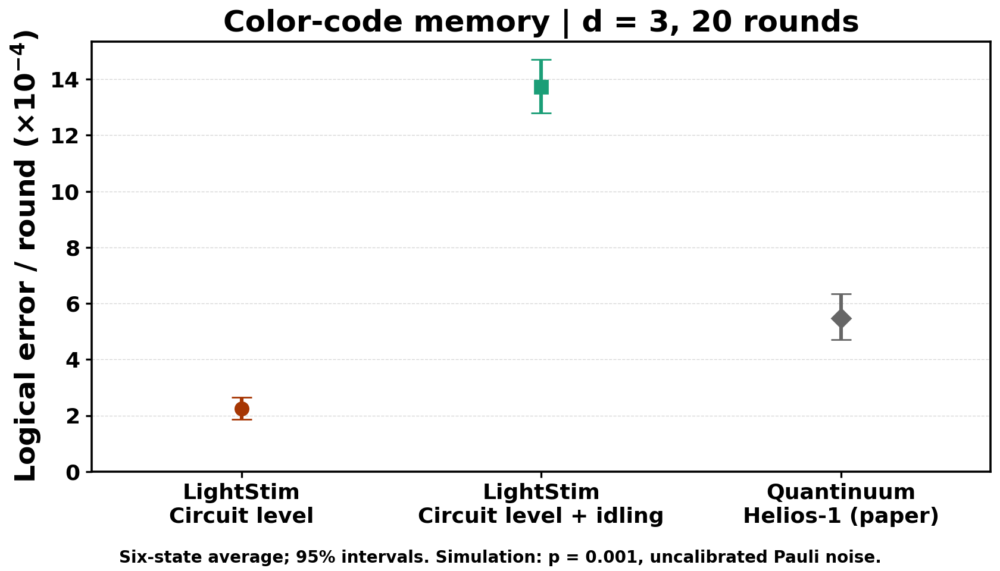

# Quantinuum color-code memory: d=3 circuit reconstruction

Reconstruct the **memory experiment** of Lavasani et al.,
[Quantum error correction well below the color code threshold](https://arxiv.org/abs/2610.24077v1),
using LightStim's `ColorCode`, atomic operations, automatic annotations, noise
injection, and `SimulationPipeline`. This is **not a calibrated Helios emulator**
or a reproduction of the paper's d=5/7 distance scaling or logical 2QRB.

[Open the executed notebook](memory.ipynb). The known Y-readout fault-distance
limitation is documented under [Interpretation and Checks](#interpretation-and-checks).

## One Protocol

1. Initialize seven data qubits in Z.
2. Measure X checks once with the **Bell-flag preparation** circuit, Fig. 8(a).
3. Rotate to one of the six signed logical Pauli states.
4. Run **20 SWAP-superdense SE rounds**, Fig. 1(b), cycling the three face schedules.
5. Rotate back and destructively measure Z; decode with Tesseract.

Preparation flags are **decoder inputs**, not postselection criteria. Every shot
is retained. The six inputs are part of the paper's memory experiment, not six
alternative protocols. SWAPs are noiseless software wire relabelings, with no
extra time step. Feedback is carried by the symbolic Pauli frame. No ideal final
SE round is added. The example uses 13 qubits: seven data and six ancillas.

## Noise Definitions

Both comparisons use `p_1q = p_2q = p_meas = p_reset = 0.001`:

| LightStim model | `p_idle` | Placement |
| --- | ---: | --- |
| `circuit_level` | 0 | Gate depolarization plus reset/readout flips |
| `circuit_level_with_idling` | 0.001 | The same channels, plus depolarization on inactive qubits per TICK-delimited moment |

The second model **replaces**, rather than adds to, the legacy `SE_start` idle
channel. TICKs describe this example's idealized schedule, not measured hardware
gate durations. Leakage, repump dynamics, transport and crosstalk are not modeled.
Rates were fixed before sampling; they are not fitted to the hardware point.

`circuit_level` also supports the legacy `SE_start` data-idle channel when
`p_idle > 0`. That option is not used here and must not be confused with
per-moment idling. The saved results use the two explicitly named configurations
above; "uniform Pauli noise" alone would not specify their different placements.



## Run

From a LightStim checkout, use an environment with LightStim, plotting/notebook
dependencies, and the optional Tesseract decoder:

```sh
python -m pip install -e '.[dev]'
python -m pip install tesseract-decoder
python -m examples.quantinuum_color_code_memory.run --shots 1000
python -m examples.quantinuum_color_code_memory.plot \
  build/examples/quantinuum_color_code_memory/results.json
```

See the [installation notes](../../README.md#quick-start) for Tesseract wheel
and CPU compatibility. `memory.ipynb` shows the full preparation and three-round
schedule with Stim's `detslice-with-ops-svg`, runs a small simulation, and plots
the stored 20-round results. Its small run is a usage example, not the source of
the reference figure. No external source-code checkout or private dependency
is required.

For the reference sample count, run with `--shots 50000 --workers 8`. This means
50,000 shots **per state per model** (600,000 total). Runtime depends on CPU and
decoder version. Normal outputs go to ignored `build/examples/`; this directory
keeps only the curated notebook, figure and small raw-count JSON.

## Interpretation and Checks

The figure uses the paper's estimator `failures / shots / (20 + 0.5)`, averaged
equally over the six inputs. The hardware point is Table 1's 178 failures in
15,840 d=3 shots, about `5.5e-4` per round. We show **95%** intervals (the paper
quotes 68%): exact binomial bounds for hardware, and the mean of simultaneous
Bonferroni-adjusted exact bounds for simulation. The latter do not assume
independent sampler streams across states. The current pipeline uses seed 0
for one worker and process-dependent seeds for multiple workers; rerunning with
multiple workers will not reproduce the exact counts. Counts, versions, decoder
settings, circuit hashes and source hashes are retained in `results.json`.
The checked-in run uses LightStim main at `96535e8` with the reference Pauli and
tracker backends; the example is also tested with native/persistent backends.
To select the reference path explicitly, set `LIGHTSTIM_PAULI_BACKEND=reference`
and `LIGHTSTIM_TRACKER_BACKEND=reference`. The recorded Tesseract settings are
our evaluation configuration, not a recovered hardware-decoder configuration.

**Known limitation:** this reconstruction's X/Z circuits have fault distance
three, but Y has a weight-two undetected-fault witness at the readout boundary:
two single faults can share a syndrome while differing by a logical flip.
The exact low-weight DEM check is included in the tests. This does not establish
a flaw in the hardware experiment or an exact match to the authors' compiler.
We retain Y in the reported six-state average and expose its individual counts;
we do not discard it or silently add an ideal round to remove the ambiguity.
The example therefore supports a scoped circuit/noise study, **not a claim of
full fault-tolerant or device-level reproduction**.

All six noiseless inputs are checked against Stim's independent flow generators:
126 detectors plus one observable span all 127 deterministic record relations
for 20 rounds. Tests also check noise placement, virtual SWAP exclusion, and a
bounded optional Tesseract pipeline smoke test. The preparation uses the public
`stabilizer_canonicalization()` API to preserve inherited Z checks; it does not
override a private tracker/builder method.

Plot colors, fonts and line styles come from `lightstim.plot.styles`.
